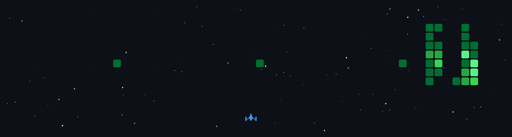

  

  

## Обо мне

Привет! Я Android-разработчик, пишу на Kotlin и Jetpack Compose.
Делаю приложения, которыми пользуюсь сам.

**Готовые проекты:**

- 📱 **DeviceBridge**: передача текста, ссылок и файлов между телефоном и компьютером через браузер, без облака
- 💰 **BudgetPlanner**: показывает, сколько можно потратить сегодня до следующего дохода, сам подтягивает траты из уведомлений банка, без аккаунта и облака

## Технологии

  

## Активность

